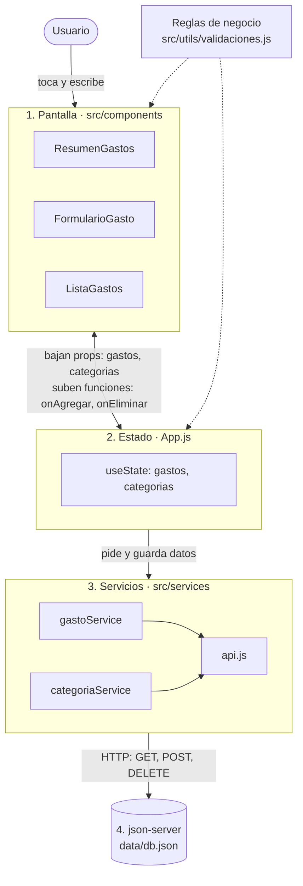
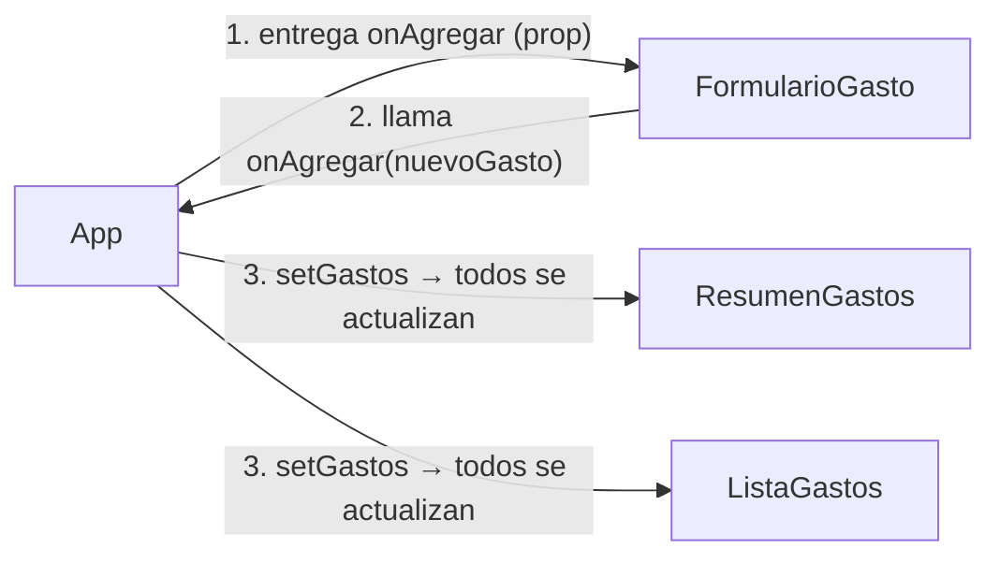
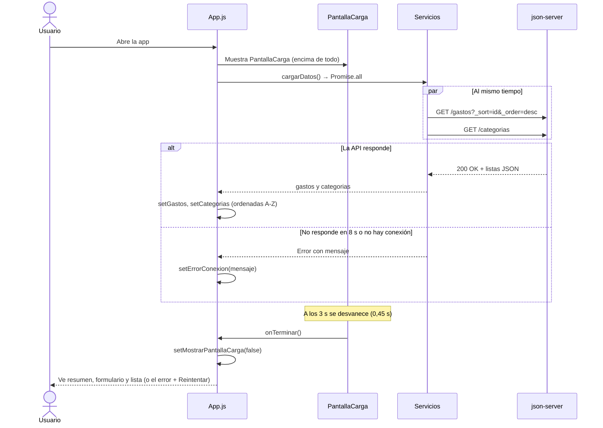
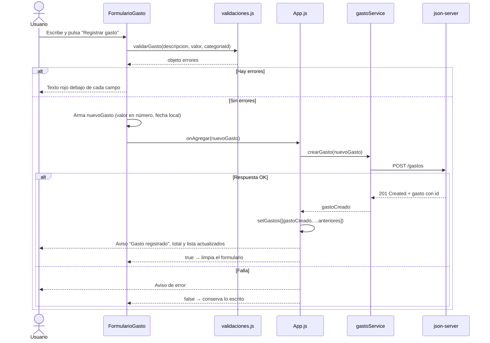
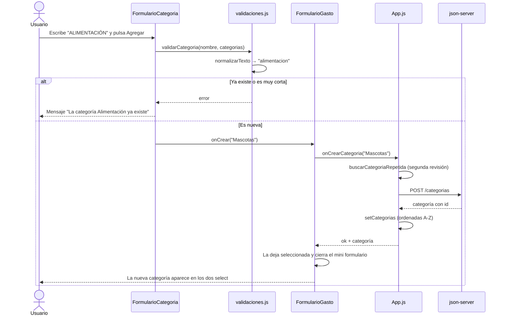
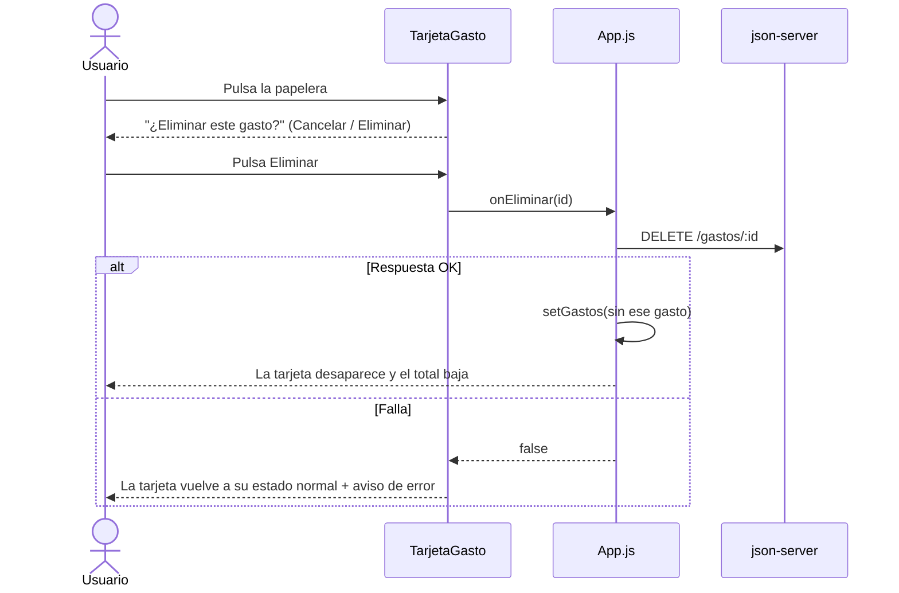
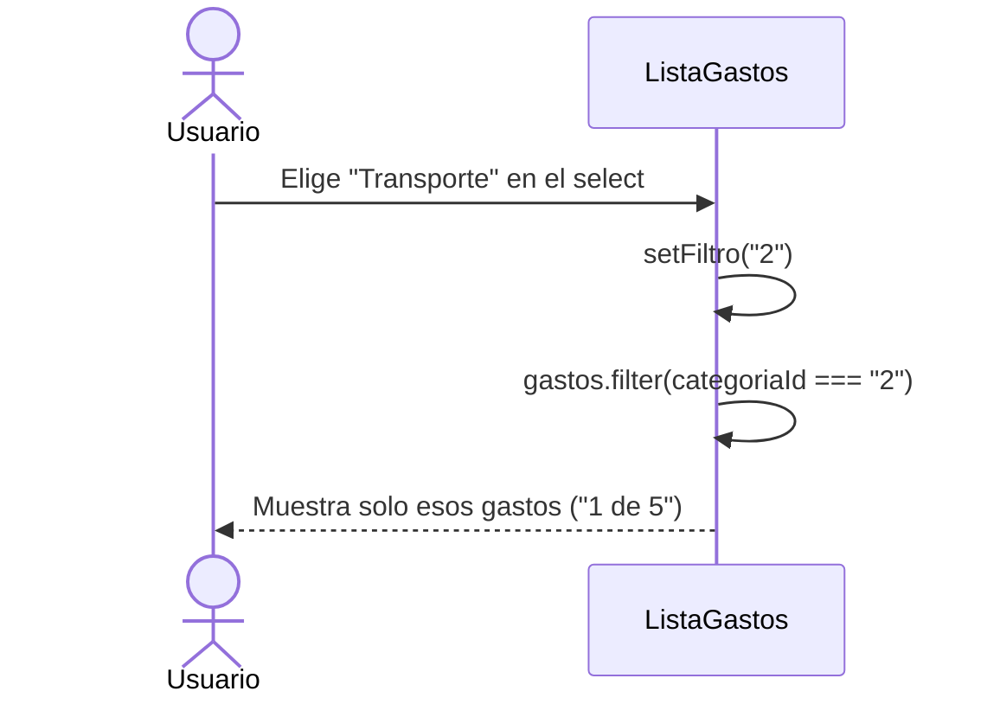
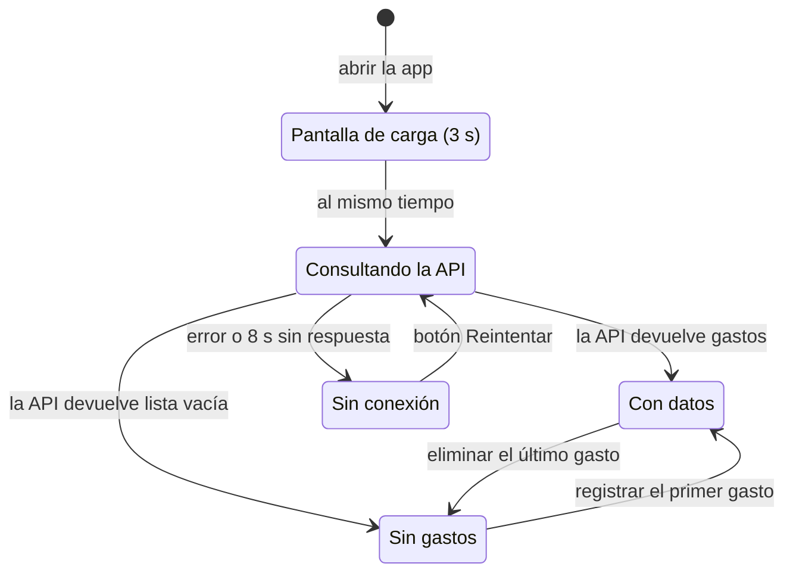
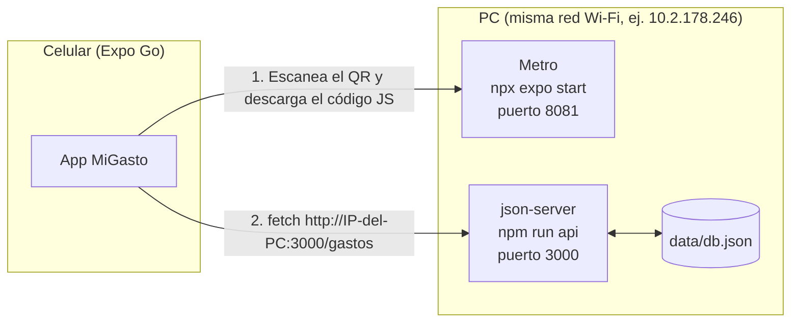

# Guía para entender MiGasto paso a paso

Esta guía explica **cómo funciona el código por dentro**, con diagramas y con fragmentos
reales del proyecto. Está pensada para que todo el equipo pueda explicar cualquier parte en la
sustentación.

- ¿Qué se entrega y cómo se cumple cada punto de la guía? → [SUSTENTACION.md](SUSTENTACION.md)
- ¿Cómo funciona el código? → esta guía

**Contenido**

1. [La app en una imagen](#1-la-app-en-una-imagen)
2. [Mapa de archivos](#2-mapa-de-archivos)
3. [Conceptos de React usados en el proyecto](#3-conceptos-de-react-usados-en-el-proyecto)
4. [Qué pasa cuando… (diagramas de secuencia)](#4-qué-pasa-cuando-diagramas-de-secuencia)
5. [Estados de la pantalla](#5-estados-de-la-pantalla)
6. [La pantalla de carga segundo a segundo](#6-la-pantalla-de-carga-segundo-a-segundo)
7. [Las validaciones con ejemplos](#7-las-validaciones-con-ejemplos)
8. [Cómo se conecta el celular con el PC](#8-cómo-se-conecta-el-celular-con-el-pc)
9. [Preguntas que puede hacer el profesor](#9-preguntas-que-puede-hacer-el-profesor)
10. [Glosario](#10-glosario)

---

## 1. La app en una imagen

La app está organizada en **capas**. Cada capa solo habla con la de al lado:



| Capa | Archivos | Qué hace | Qué NO hace |
|---|---|---|---|
| Pantalla | `src/components/*` | Dibuja y captura lo que el usuario hace | No llama a la API |
| Estado | `App.js` | Guarda los datos y decide qué cambia | No dibuja detalles de cada parte |
| Servicios | `src/services/*` | Habla con la API por HTTP | No sabe nada de la pantalla |
| Reglas | `src/utils/validaciones.js` | Dice si los datos son válidos | No muestra nada |
| Datos | `data/db.json` | Guarda gastos y categorías | — |

---

## 2. Mapa de archivos

| Archivo | Qué hace | Lo usa |
|---|---|---|
| `index.js` | Registra `App` como componente raíz (lo generó Expo) | Expo |
| `App.js` | Estado principal, llamadas a la API, arma la pantalla | `index.js` |
| `src/components/PantallaCarga.js` | Splash animado de 3 s | `App.js` |
| `src/components/Encabezado.js` | Header azul con logo y mes actual | `App.js` |
| `src/components/Logo.js` | Logo de billetera con insignia `$` | `Encabezado`, `PantallaCarga` |
| `src/components/ResumenGastos.js` | Calcula y muestra total y cantidad | `App.js` |
| `src/components/FormularioGasto.js` | Formulario de descripción, categoría y valor | `App.js` |
| `src/components/SelectCategoria.js` | Lista desplegable (Picker) de categorías | `FormularioGasto`, `ListaGastos` |
| `src/components/FormularioCategoria.js` | Mini formulario para crear categoría | `FormularioGasto` |
| `src/components/ListaGastos.js` | Lista con filtro y estados (cargando / vacío) | `App.js` |
| `src/components/TarjetaGasto.js` | Un gasto + botón eliminar con confirmación | `ListaGastos` |
| `src/components/Mensaje.js` | Caja de éxito, error o información | `App.js`, `FormularioCategoria`, `AvisoFlotante` |
| `src/components/AvisoFlotante.js` | Mensaje flotante temporal (toast) | `App.js` |
| `src/services/api.js` | URL de la API y función `peticion()` | Los otros servicios |
| `src/services/gastoService.js` | `obtenerGastos`, `crearGasto`, `eliminarGasto` | `App.js` |
| `src/services/categoriaService.js` | `obtenerCategorias`, `crearCategoria` | `App.js` |
| `src/utils/validaciones.js` | Reglas de negocio | Formularios y `App.js` |
| `src/utils/formato.js` | Moneda (`$ 15.000`) y fechas | Varios componentes |
| `src/theme/colores.js` | Paleta de colores | Todos los componentes |
| `data/db.json` | Datos simulados (6 categorías, 5 gastos) | json-server |

---

## 3. Conceptos de React usados en el proyecto

Cada concepto tiene un ejemplo **copiado del proyecto**.

### 3.1 Componente

Una función que devuelve lo que se dibuja (JSX). Su nombre empieza con mayúscula.

```js
// src/components/ResumenGastos.js
export default function ResumenGastos({ gastos }) {
  const total = gastos.reduce((acumulado, gasto) => acumulado + Number(gasto.valor), 0);
  const cantidad = gastos.length;
  return ( /* tarjetas con total y cantidad */ );
}
```

### 3.2 Props (datos que bajan)

El padre le pasa datos al hijo como si fueran atributos. El hijo **no puede cambiarlos**.

```js
// App.js
<ResumenGastos gastos={gastos} />
```

### 3.3 Estado con `useState` (datos que cambian)

Cuando se llama a la función `set…`, React vuelve a dibujar todo lo que usa ese dato.

```js
// App.js
const [gastos, setGastos] = useState([]);       // empieza como lista vacía
setGastos((anteriores) => [gastoCreado, ...anteriores]);  // agrega al inicio
```

Se usa la forma `(anteriores) => …` para trabajar siempre con el valor más reciente.

### 3.4 Funciones como props (el hijo avisa al padre)

El padre le entrega una función; el hijo la llama cuando pasa algo.

```js
// App.js entrega la función
<FormularioGasto onAgregar={agregarGasto} … />

// FormularioGasto.js la llama con el gasto ya validado
const guardado = await onAgregar(nuevoGasto);
```



### 3.5 `useEffect` (hacer algo al iniciar)

Ejecuta código después de dibujar. Con `[cargarDatos]` como dependencia se ejecuta **una vez**
al abrir la app, porque `cargarDatos` nunca cambia.

```js
// App.js
useEffect(() => {
  cargarDatos();                                   // GET a la API al iniciar
  return () => clearTimeout(temporizadorAviso.current);  // limpieza al cerrar
}, [cargarDatos]);
```

### 3.6 `useCallback` (una función que no cambia)

`cargarDatos` se crea con `useCallback(..., [])` para que sea siempre la misma función.
Así el `useEffect` anterior no se repite en cada renderizado y el botón "Reintentar" puede
reutilizarla.

### 3.7 `useMemo` (un cálculo que se guarda)

Une cada gasto con el nombre de su categoría. Solo se recalcula si cambian `gastos` o `categorias`.

```js
// App.js
const gastosConCategoria = useMemo(
  () => gastos.map((gasto) => {
    const categoria = categorias.find((item) => String(item.id) === String(gasto.categoriaId));
    return { ...gasto, categoria: categoria ? categoria.nombre : 'Sin categoría' };
  }),
  [gastos, categorias]
);
```

### 3.8 `useRef` (guardar algo sin volver a dibujar)

- En `App.js` guarda el temporizador del aviso flotante para poder cancelarlo.
- En `PantallaCarga.js` guarda los valores de las animaciones (`new Animated.Value(0)`).

### 3.9 `async` / `await` y `fetch`

`fetch` pide datos por HTTP y tarda; `await` espera la respuesta sin congelar la app.
`Promise.all` hace dos peticiones **al mismo tiempo**:

```js
// App.js → cargarDatos
const [listaGastos, listaCategorias] = await Promise.all([
  obtenerGastos(),
  obtenerCategorias(),
]);
```

`try / catch / finally` maneja los errores: si falla, se guarda el mensaje en `errorConexion`.

### 3.10 Renderizado condicional

Mostrar algo solo si se cumple una condición:

```js
// App.js
{errorConexion && <Mensaje tipo="error" texto={errorConexion} … />}
{mostrarPantallaCarga && <PantallaCarga … />}
```

### 3.11 Listas con `map` y `key`

```js
// ListaGastos.js
gastosFiltrados.map((gasto) => (
  <TarjetaGasto key={gasto.id} gasto={gasto} onEliminar={onEliminar} />
))
```

`key` le dice a React qué tarjeta es cuál, para actualizar solo la que cambió.

### 3.12 Estilos con `StyleSheet`

No hay CSS: los estilos son objetos de JavaScript. Los colores están centralizados en
`src/theme/colores.js`, así que cambiar el color principal es editar un solo archivo.

---

## 4. Qué pasa cuando… (diagramas de secuencia)

Un diagrama de secuencia muestra **quién llama a quién y en qué orden**, de arriba hacia abajo.

### 4.1 …abro la app



### 4.2 …registro un gasto



### 4.3 …creo una categoría



### 4.4 …elimino un gasto



### 4.5 …filtro por categoría

Es el único proceso que **no** pasa por App ni por la API: el filtro es estado local de
`ListaGastos`.



---

## 5. Estados de la pantalla

La misma pantalla se ve distinta según el estado de los datos:



| Estado | Qué ve el usuario | Variable que lo controla |
|---|---|---|
| Pantalla de carga | Logo animado y barra de progreso | `mostrarPantallaCarga` |
| Consultando la API | "Consultando gastos..." con un indicador | `cargandoDatos` |
| Sin conexión | Mensaje rojo + Reintentar, formulario bloqueado | `errorConexion` |
| Sin gastos | "No hay gastos registrados." | `gastos.length === 0` |
| Con datos | Resumen, formulario y lista | `gastos` con elementos |

---

## 6. La pantalla de carga segundo a segundo

`PantallaCarga.js` usa la API `Animated` de React Native. Todo arranca al montarse:

| Momento | Qué pasa | Código |
|---|---|---|
| 0 s | Aparece (opacidad 0 → 1 en 0,5 s) y el logo crece con efecto resorte | `Animated.timing` + `Animated.spring` |
| 0 s → siempre | El logo "late": crece a 1,08 y vuelve, cada 1,2 s | `Animated.loop` |
| 0 s → 3 s | La barra verde se llena del 0 al 100 % | `Animated.timing(progreso)` |
| 0 s | En paralelo, `App.js` consulta la API | `useEffect → cargarDatos()` |
| 3 s | Se desvanece (opacidad 1 → 0 en 0,45 s) | `setTimeout(…, duracion)` |
| 3,45 s | Avisa a App con `onTerminar()` y App la quita | `setMostrarPantallaCarga(false)` |

La pantalla de carga se dibuja **encima** del contenido (`position: absolute`). Por eso, cuando
se desvanece, la app ya está lista debajo y la transición se ve fluida.

---

## 7. Las validaciones con ejemplos

Todas están en `src/utils/validaciones.js` y se probaron con Node.

**`normalizarTexto()`**: minúsculas, sin tildes, sin espacios extra (la ñ se conserva).

| Lo que escribe el usuario | Texto normalizado | ¿Repetida si ya existe "Alimentación"? |
|---|---|---|
| `ALIMENTACIÓN` | `alimentacion` | Sí |
| `alimentacion  ` | `alimentacion` | Sí |
| `Ali ment` | `ali ment` | No |
| `mascotas` | `mascotas` | No, se guarda como "Mascotas" |

**`convertirValor()` y `validarGasto()`** con el campo valor:

| Valor escrito | Número | Resultado |
|---|---|---|
| `15000` | 15000 | Válido |
| `15.000` | 15000 | Válido (punto de miles) |
| `1.234.567` | 1234567 | Válido |
| `$ 8.000` | 8000 | Válido |
| `15,5` | 15.5 | Válido |
| `0` | 0 | "El valor debe ser mayor que cero." |
| `-5000` | -5000 | "El valor debe ser mayor que cero." |
| `abc` | NaN | "El valor debe ser numérico." |
| (vacío) | — | "El valor es obligatorio." |

**`validarCategoria()`** con el nombre nuevo:

| Nombre | Resultado |
|---|---|
| (vacío) | "Escribe el nombre de la categoría." |
| `ab` | "La categoría debe tener al menos 3 letras." |
| `ALIMENTACIÓN` | "La categoría "Alimentación" ya existe. Selecciónala en la lista." |
| `  comida   RÁPIDA ` | Válida, se guarda como "Comida rápida" |

---

## 8. Cómo se conecta el celular con el PC

Para probar en el celular hay **dos servidores** en el PC: Metro entrega el código de la app y
json-server entrega los datos.



- `localhost` en el celular es **el propio celular**, no el PC. Por eso `api.js` usa la IP que
  Expo informa en `Constants.expoConfig.hostUri`.
- json-server se enciende con `--host 0.0.0.0` para aceptar conexiones desde la red, no solo
  desde el mismo PC.
- En el navegador (Windows) la app usa el mismo host de la página (`localhost`).

---

## 9. Preguntas que puede hacer el profesor

**¿Por qué el estado está en App.js y no en cada componente?**
Porque `gastos` lo usan tres componentes (resumen, formulario y lista). Si cada uno tuviera
su copia, se desincronizarían. Al tenerlo en el padre común, un solo `setGastos` actualiza todo.

**¿Cuál es la diferencia entre props y estado?**
El estado lo guarda y lo cambia el propio componente (`useState`). Las props las recibe del
padre y no las puede cambiar; para pedir un cambio llama una función que el padre le dio.

**¿Cómo se comunica un hijo con el padre?**
Con funciones que el padre entrega como props: `onAgregar`, `onEliminar`, `onCrearCategoria`,
`onTerminar`.

**¿Qué hace el `useEffect` de App.js?**
Llama a `cargarDatos()` una sola vez al iniciar, para traer gastos y categorías de la API. La
función de limpieza cancela el temporizador del aviso si la app se cierra.

**¿Para qué sirve `useMemo`?**
Para no recalcular la unión gasto + nombre de categoría en cada renderizado, solo cuando
cambian `gastos` o `categorias`.

**¿Cómo evitan las categorías repetidas, incluso con mayúsculas o tildes?**
`normalizarTexto()` convierte el nombre a minúsculas, quita tildes y espacios extra, y lo
compara con cada categoría existente normalizada. `ALIMENTACIÓN` y `alimentacion` dan
`alimentacion`.

**¿Por qué validan la categoría dos veces (formulario y App)?**
El formulario la valida para mostrar el mensaje al usuario. App la vuelve a revisar justo antes
del POST porque es quien registra los datos. Igual, una API real debe validar también en el
servidor.

**¿Qué pasa si la API está apagada?**
`peticion()` lanza un error claro; App lo guarda en `errorConexion`, muestra el mensaje con
"Reintentar" y bloquea el formulario. Si la API tarda más de 8 s, `AbortController` cancela la
petición.

**¿Por qué no usaron `Alert.alert` como en el taller?**
Porque no funciona en la versión web y la app también debía probarse en Windows. Se creó el
componente `Mensaje`, que funciona igual en web y en el celular.

**¿Por qué la lista usa `map` y no `FlatList`?**
Porque la lista está dentro de un `ScrollView`, y meter una `FlatList` dentro genera una
advertencia de React Native. Para pocos gastos, `map` es suficiente.

**¿Qué es json-server?**
Una herramienta que convierte un archivo JSON en una API REST con GET, POST, PUT y DELETE.
Sirve para simular el backend. Con una API real solo cambiaría la URL en `api.js`.

**¿Cómo logran que la pantalla de carga dure 3 segundos?**
Con un `setTimeout` de 3000 ms dentro de un `useEffect` en `PantallaCarga.js`; al cumplirse
ejecuta la animación de salida y luego `onTerminar()`.

**¿Qué es un componente reutilizable? Den ejemplos.**
Uno que se escribe una vez y se usa en varios lugares con props distintas: `SelectCategoria`
(formulario y filtro), `Logo` (header y pantalla de carga) y `Mensaje` (error de conexión,
categoría repetida y avisos).

**¿Por qué el select maneja los ids como texto?**
Porque en web el `Picker` devuelve el valor como texto (`"1"`) y la API usa números (`1`).
Se comparan con `String(...)` y se convierten con `Number(...)` al guardar.

---

## 10. Glosario

| Término | Significado |
|---|---|
| Componente | Función que devuelve una parte de la interfaz |
| JSX | La sintaxis parecida a HTML que se escribe dentro de JavaScript |
| Props | Datos que un componente padre le pasa a un hijo |
| Estado | Datos que cambian y hacen que la pantalla se vuelva a dibujar |
| Hook | Función de React que empieza con `use` (`useState`, `useEffect`…) |
| Callback | Función que se pasa a otra para que la llame después |
| Renderizar | Dibujar (o volver a dibujar) un componente |
| API REST | Servicio que entrega y recibe datos por HTTP con rutas y métodos |
| Endpoint | Una ruta de la API, por ejemplo `GET /gastos` |
| JSON | Formato de texto para datos: `{ "id": 1, "nombre": "Salud" }` |
| Mock data | Datos de prueba que simulan los de una base real |
| Promesa | Valor que llegará después (resultado de `fetch`); se espera con `await` |
| Metro | El servidor que empaqueta el código JavaScript de la app |
| Expo Go | App del celular que ejecuta el proyecto sin instalarlo |
