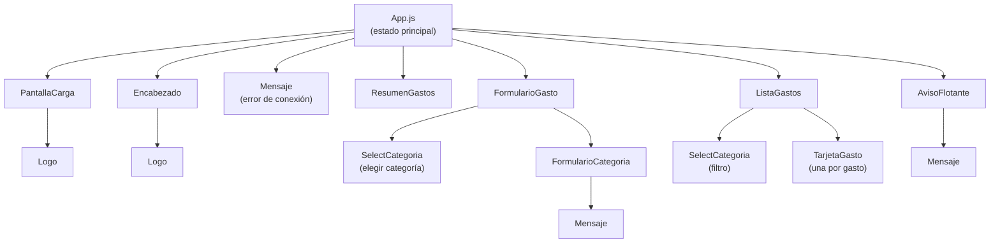
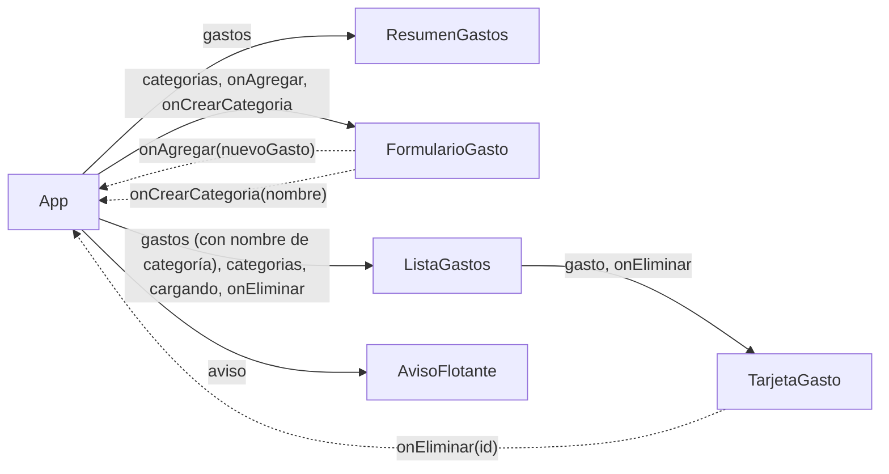
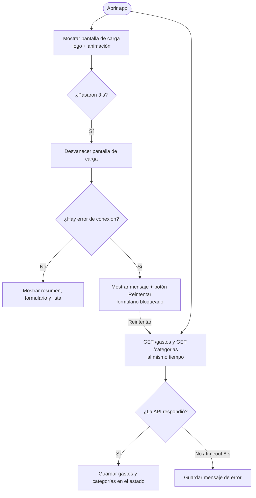
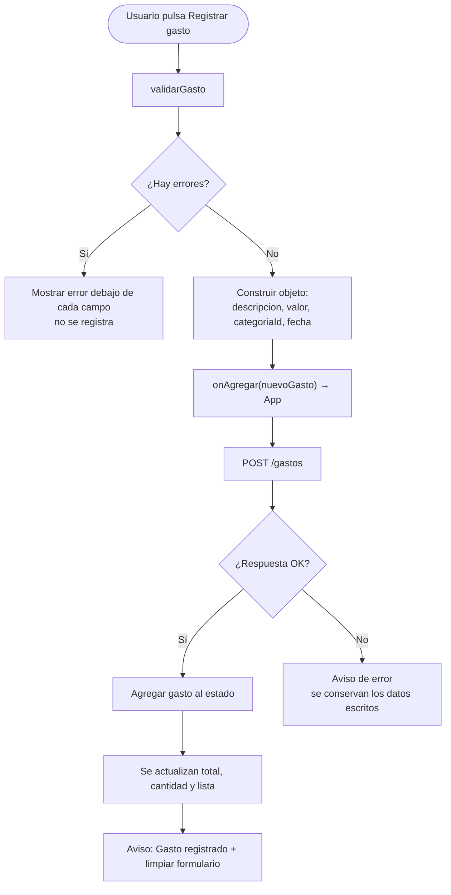
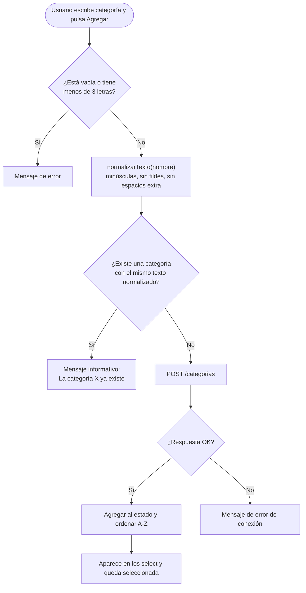
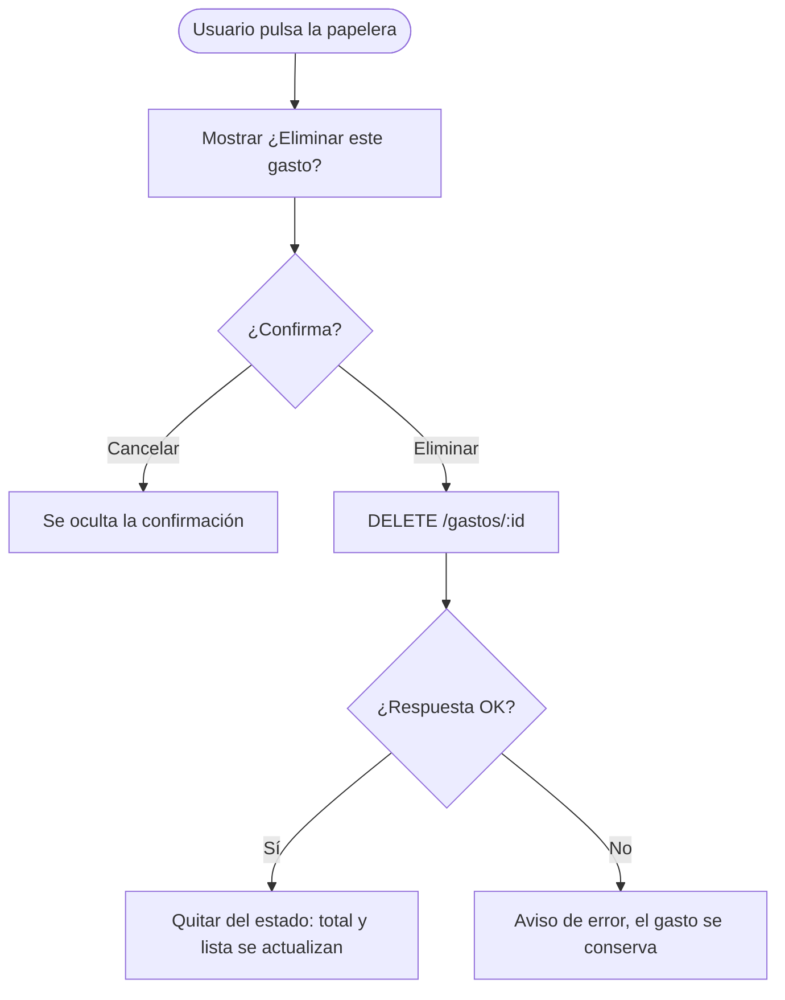
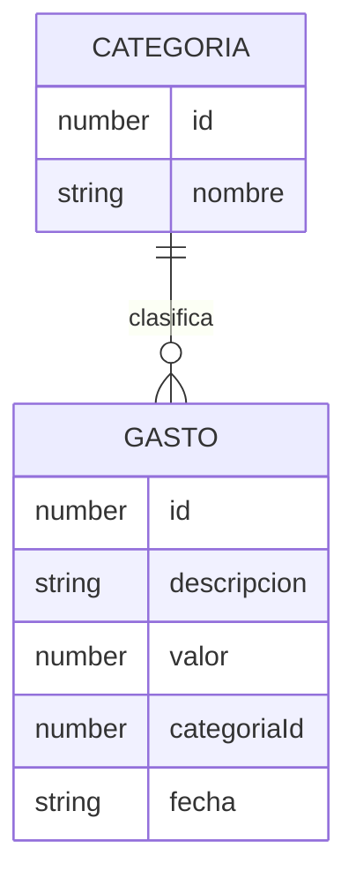
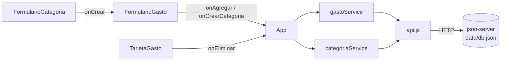
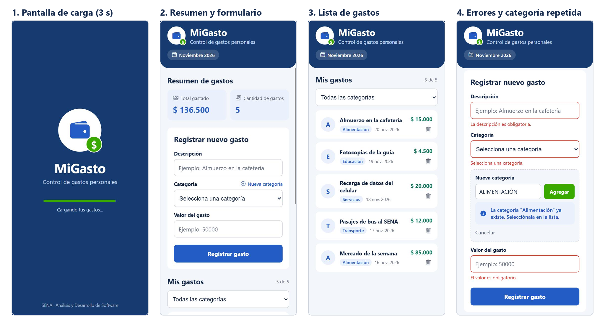

# MiGasto Móvil – Documentación para la sustentación

Este documento cubre los puntos que pide la guía **"Entrega de actividades – Retos de desarrollo móvil"**
y el **reto de la segunda versión**. Cada sección indica a qué punto de la guía responde.

> Los diagramas están en formato **Mermaid**. Se ven como imagen en GitHub y en VS Code
> (con la extensión *Markdown Preview Mermaid Support*). También se pueden pegar en
> <https://mermaid.live> para exportarlos como PNG.

---

## 1. Planteamiento de la solución (guía 2.1)

**Problema:** las personas hacen pequeños gastos diarios y no llevan un registro organizado,
por eso no saben en qué se les va el dinero.

**Solución:** MiGasto es una app móvil sencilla que permite:

| Requisito | Cómo se cumple |
|---|---|
| RF01 Resumen de gastos | `ResumenGastos` muestra el total gastado y la cantidad de gastos. |
| RF02 Registrar gasto | `FormularioGasto` pide descripción, categoría (select) y valor; la fecha se asigna sola. |
| RF03 Listar gastos | `ListaGastos` + `TarjetaGasto` muestran categoría, descripción, valor y fecha. |
| RF04 Calcular total | `reduce()` sobre la lista de gastos. |
| RF05 Filtrar por categoría | Select de filtro en `ListaGastos`. |
| RF06 Informar errores y éxitos | Componentes `Mensaje` y `AvisoFlotante`. |
| RF07 Consumir una API REST | Servicios en `src/services/` con `fetch` contra json-server. |

**Cómo se organizó el desarrollo:**

1. Versión 1 del taller: todo en `App.js`.
2. Reto 1: separar componentes, agregar select, validar categorías repetidas
   (sin distinguir mayúsculas) y recuperar el campo descripción.
3. Versión 2: API REST, header con logo, pantalla de carga y presentación completa de cada gasto.

---

## 2. Arquitectura de componentes (guía 2.2 y 3.2)

### Árbol de componentes



Versión en texto:

```
App
├── PantallaCarga ─── Logo
├── Encabezado ────── Logo
├── Mensaje (error de conexión)
├── ResumenGastos
├── FormularioGasto
│   ├── SelectCategoria
│   └── FormularioCategoria ─── Mensaje
├── ListaGastos
│   ├── SelectCategoria (filtro)
│   └── TarjetaGasto (x cada gasto)
└── AvisoFlotante ─── Mensaje
```

### Componente principal y responsabilidades

`App.js` es el **componente principal**. Es el único que:

- guarda el estado principal (`gastos`, `categorias`),
- llama a los servicios de la API,
- decide qué mostrar (pantalla de carga, error de conexión, avisos).

Los demás componentes son **hijos**: reciben datos por props y avisan al padre mediante funciones.

### Composición y tipología de componentes (guía 3.3)

| Componente | Tipo | Responsabilidad | Elementos que lo forman | Información que necesita (props) |
|---|---|---|---|---|
| `App` | Contenedor (con estado) | Administrar estado, consumir API, coordinar hijos | `SafeAreaProvider`, `ScrollView`, hijos | — |
| `PantallaCarga` | Presentación con animación | Splash de 3 s con logo y barra de progreso | `Animated.View`, `Logo`, `Text` | `duracion`, `onTerminar` |
| `Encabezado` | Presentación | Mostrar marca, nombre de la app y mes actual | `Logo`, `Text`, ícono | — |
| `Logo` | Presentación **reutilizable** | Dibujar el logo propio | `View`, ícono `wallet`, insignia `$` | `tamano` |
| `ResumenGastos` | Presentación (calcula) | Total gastado y cantidad de gastos | 2 tarjetas `View` + `Text` | `gastos` |
| `FormularioGasto` | Formulario (estado local) | Capturar y validar un gasto nuevo | `TextInput`, `SelectCategoria`, `Pressable` | `categorias`, `onAgregar`, `onCrearCategoria`, `deshabilitado` |
| `SelectCategoria` | Control **reutilizable** | Lista desplegable de categorías | `Picker` + `Picker.Item` | `categorias`, `valor`, `onCambiar`, `textoVacio`, `conError`, `deshabilitado` |
| `FormularioCategoria` | Formulario (estado local) | Crear categoría sin repetir | `TextInput`, `Pressable`, `Mensaje` | `categorias`, `onCrear`, `onCancelar` |
| `ListaGastos` | Contenedor de lista (estado local de filtro) | Listar, filtrar y mostrar estados (cargando / vacío) | `SelectCategoria`, `TarjetaGasto`, `ActivityIndicator` | `gastos`, `categorias`, `cargando`, `onEliminar` |
| `TarjetaGasto` | Presentación (estado local de confirmación) | Mostrar un gasto y pedir confirmación para eliminar | `View`, `Text`, `Pressable` | `gasto`, `onEliminar` |
| `Mensaje` | Presentación **reutilizable** | Mensaje de éxito, error o información | ícono, `Text`, botón opcional | `tipo`, `texto`, `accion`, `style` |
| `AvisoFlotante` | Presentación | Mostrar un `Mensaje` flotante temporal | `Mensaje` | `aviso` |

### Justificación de la separación

- **Mantenimiento:** si cambia el diseño del listado, solo se toca `ListaGastos` / `TarjetaGasto`.
- **Reutilización:** `SelectCategoria` se usa en el formulario y en el filtro; `Logo` en el
  encabezado y en la pantalla de carga; `Mensaje` en 3 lugares.
- **Responsabilidad única:** la interfaz no conoce la URL de la API (eso está en `services/`) y
  las reglas de negocio no están en la interfaz (están en `utils/validaciones.js`).
- **Pruebas:** las validaciones son funciones puras, se pueden probar sin abrir la app.

---

## 3. Relaciones y comunicación entre componentes (guía 2.3 y 3.4)



*Línea continua = datos que bajan por props. Línea punteada = el hijo llama una función del padre.*

| Componente | Recibe por props | Envía / comunica al padre |
|---|---|---|
| `ResumenGastos` | `gastos` | Nada (solo muestra) |
| `FormularioGasto` | `categorias`, `onAgregar`, `onCrearCategoria`, `deshabilitado` | `onAgregar({ descripcion, valor, categoriaId, fecha })` y `onCrearCategoria(nombre)` |
| `FormularioCategoria` | `categorias`, `onCrear`, `onCancelar` | `onCrear(nombre)` a `FormularioGasto` |
| `SelectCategoria` | `categorias`, `valor`, `onCambiar`… | `onCambiar(id)` |
| `ListaGastos` | `gastos`, `categorias`, `cargando`, `onEliminar` | Pasa `onEliminar` a cada tarjeta |
| `TarjetaGasto` | `gasto`, `onEliminar` | `onEliminar(id)` |
| `PantallaCarga` | `duracion`, `onTerminar` | `onTerminar()` cuando termina la animación |

**¿Dónde está el estado?**

| Estado | Dónde vive | Por qué |
|---|---|---|
| `gastos`, `categorias` | `App` | Los usan varios hijos (resumen, formulario, lista). |
| `cargandoDatos`, `errorConexion`, `aviso`, `mostrarPantallaCarga` | `App` | Afectan a toda la pantalla. |
| Texto que se está escribiendo (`descripcion`, `valor`, `categoriaId`, `errores`) | `FormularioGasto` | Solo le importa al formulario hasta que se registra. |
| `filtro` | `ListaGastos` | Es un estado de la interfaz que solo usa la lista. |
| `confirmando` | `TarjetaGasto` | Solo afecta a esa tarjeta. |

**¿Cómo se actualizan los datos?** El hijo nunca modifica el estado del padre directamente:
llama una función (`onAgregar`, `onEliminar`…). `App` llama a la API y, si responde bien,
actualiza el estado con `setGastos` / `setCategorias`. React vuelve a dibujar los componentes que
usan ese estado: el resumen recalcula el total y la lista muestra el cambio.

**Eventos que cambian la interfaz:**

| Evento del usuario | Qué cambia |
|---|---|
| Abrir la app | Pantalla de carga → GET a la API → resumen y lista |
| Pulsar "Registrar gasto" | Errores en el formulario, o POST → nuevo gasto en lista y total |
| Pulsar "Nueva categoría" → "Agregar" | Mensaje de repetida, o POST → nueva opción en los select |
| Cambiar el filtro | La lista muestra solo esa categoría |
| Papelera → "Eliminar" | DELETE → el gasto desaparece y el total baja |
| Pulsar "Reintentar" | Se vuelve a consultar la API |

---

## 4. Lógica de negocio y flujos (guía 2.4 y 3.5)

### Reglas de negocio y validaciones (`src/utils/validaciones.js`)

| Código | Regla |
|---|---|
| RN01 | La **descripción** es obligatoria y tiene máximo 60 caracteres. |
| RN02 | La **categoría** es obligatoria y se elige del select. |
| RN03 | El **valor** es obligatorio, numérico y mayor que cero. Se acepta el punto de miles: `15.000` = 15000. |
| RN04 | Una categoría nueva debe tener entre 3 y 30 caracteres. |
| RN05 | **No se pueden repetir categorías.** Se comparan sin importar mayúsculas, minúsculas, tildes ni espacios extra: `Alimentación`, `ALIMENTACIÓN`, `alimentacion` son la misma. Se muestra un mensaje informativo. |
| RN06 | El nombre de la categoría se guarda con la primera letra en mayúscula (`comida RÁPIDA` → `Comida rápida`). |
| RN07 | La fecha del gasto es la fecha local del dispositivo al registrarlo. |
| RN08 | Total = suma de los valores; si no hay gastos, el total es $0. |
| RN09 | Si la API no responde en 8 s o no hay conexión, se informa y se ofrece "Reintentar"; el formulario se bloquea. |
| RN10 | Eliminar un gasto pide confirmación. |

> La validación en la app mejora la experiencia, pero **no reemplaza** la validación del backend.
> json-server no valida nada; en una API real estas reglas también deben estar en el servidor.

### Flujo: inicio de la aplicación



### Flujo: registrar un gasto



### Flujo: crear una categoría (validación de repetidas)



### Flujo: eliminar un gasto



---

## 5. Estructura de datos y mock data (guía 2.4 y 3.6)

Los datos simulados están en **`data/db.json`**. json-server lo convierte en una API REST.

### Objetos

**Categoría**

| Campo | Tipo | Obligatorio | Descripción |
|---|---|---|---|
| `id` | number | Sí (lo asigna la API) | Identificador único |
| `nombre` | string | Sí | Nombre único (sin repetir) |

**Gasto**

| Campo | Tipo | Obligatorio | Descripción |
|---|---|---|---|
| `id` | number | Sí (lo asigna la API) | Identificador único |
| `descripcion` | string | Sí | Máx. 60 caracteres |
| `valor` | number | Sí | Pesos colombianos, mayor que 0 |
| `categoriaId` | number | Sí | **Relación** con `categorias.id` |
| `fecha` | string `AAAA-MM-DD` | Sí | Fecha del registro |

### Relación entre los datos



Una categoría puede tener muchos gastos. El gasto guarda solo el `categoriaId`; `App.js` busca el
nombre de la categoría (`gastosConCategoria`) para mostrarlo en la tarjeta.

### Cómo se extraen, procesan y distribuyen

1. `gastoService.obtenerGastos()` y `categoriaService.obtenerCategorias()` traen los datos (GET).
2. `App.js` los guarda en el estado y ordena las categorías de la A a la Z.
3. `App.js` une cada gasto con el nombre de su categoría (`useMemo`).
4. Se reparten por props: `gastos` → `ResumenGastos`; `categorias` → `FormularioGasto`;
   gastos con categoría → `ListaGastos` → `TarjetaGasto`.

### Ejemplos de respuestas de la API

`GET /categorias` → `200 OK`

```json
[
  { "id": 1, "nombre": "Alimentación" },
  { "id": 2, "nombre": "Transporte" }
]
```

`POST /gastos` con el cuerpo:

```json
{ "descripcion": "Almuerzo", "valor": 15000, "categoriaId": 1, "fecha": "2026-11-23" }
```

responde `201 Created`:

```json
{ "descripcion": "Almuerzo", "valor": 15000, "categoriaId": 1, "fecha": "2026-11-23", "id": 6 }
```

`DELETE /gastos/6` → `200 OK` con `{}`

`GET /gastos/999` (no existe) → `404 Not Found` con `{}`

---

## 6. Servicios, rutas y API (guía 3.7)

### Endpoints

| Método | Ruta | Uso | Función del servicio | Implementado |
|---|---|---|---|---|
| GET | `/gastos?_sort=id&_order=desc` | Listar gastos, el más reciente primero | `obtenerGastos()` | Sí |
| POST | `/gastos` | Registrar gasto | `crearGasto(gasto)` | Sí |
| DELETE | `/gastos/:id` | Eliminar gasto | `eliminarGasto(id)` | Sí |
| GET | `/categorias` | Listar categorías (llenar el select) | `obtenerCategorias()` | Sí |
| POST | `/categorias` | Crear categoría | `crearCategoria(nombre)` | Sí |
| PUT | `/gastos/:id` | Editar un gasto | — | Propuesto (siguiente versión) |
| GET | `/gastos?categoriaId=1` | Filtrar en el servidor | — | Propuesto (siguiente versión) |

### Organización de los archivos de servicios

```
src/services/
├── api.js               # API_URL + función peticion(): fetch, encabezados, timeout y errores
├── gastoService.js      # Operaciones de /gastos
└── categoriaService.js  # Operaciones de /categorias
```

- `api.js` calcula la URL: en el celular usa la IP del PC (la entrega Expo en `hostUri`), en el
  navegador usa el mismo host de la página. Corta la petición a los 8 s (`AbortController`) y
  convierte los fallos en mensajes entendibles.
- Los componentes **nunca** llaman a `fetch` directamente: solo `App.js` usa los servicios.

### Relación servicios ↔ componentes



---

## 7. Estrategia de depuración (guía 2.5)

### Herramientas usadas

- **Consola del navegador (F12)** al correr la app con `w` (web).
- **Terminal de Metro** (`npx expo start`): errores de compilación y `console.log`.
- **Pestaña Network / la URL de la API en el navegador** (`http://localhost:3000/gastos`) para ver
  qué devuelve la API.
- **`npx expo-doctor`**: revisa dependencias incompatibles o faltantes.
- **`npx expo export --platform android`**: confirma que el código compila para Android.
- **Pruebas de las validaciones con Node**: llamar `validarCategoria`, `convertirValor` y
  `validarGasto` con casos límite.

### Problemas identificados y cómo se resolvieron

| # | Problema | Cómo se identificó | Solución |
|---|---|---|---|
| 1 | En el celular, `fetch('http://localhost:3000')` no llega a la API: `localhost` es el propio celular, no el PC. | Analizando dónde corre cada parte: la API está en el PC y la app en el celular. | `api.js` toma la IP del PC desde `Constants.expoConfig.hostUri`; json-server se ejecuta con `--host 0.0.0.0`. |
| 2 | `Alert.alert` (usado en el taller) no está implementado en la versión web de React Native, así que en Windows los mensajes no se verían. | Revisando la compatibilidad de los componentes con web antes de probar en el navegador. | Se creó el componente `Mensaje` (y `AvisoFlotante`) que funciona igual en web y en el celular. La confirmación de eliminar se hace dentro de la tarjeta. |
| 3 | El `Picker` en web devuelve el valor seleccionado como **texto** (`"1"`), mientras la API usa números (`1`). Comparar `"1" === 1` da `false`. | Revisando el código fuente del Picker para web. | Los ids en los select se manejan como texto y se comparan con `String(...)`; al guardar se convierten con `Number(...)`. |
| 4 | `new Date().toISOString().slice(0, 10)` (código del taller) devuelve la fecha **UTC**: en Colombia, después de las 7:00 p. m. guardaría la fecha del día siguiente. | Revisando el comportamiento de `toISOString`. | `fechaHoy()` en `formato.js` arma la fecha con la hora local. |
| 5 | `new Date('2026-11-20')` se interpreta como medianoche UTC; mostrada con la hora de Colombia (UTC-5) saldría **19 nov**. | Revisando cómo JavaScript interpreta las fechas sin hora. | `formatoFecha()` separa el texto `AAAA-MM-DD` sin usar zona horaria. |
| 6 | `Number('15.000')` da `15`, no `15000` (el usuario colombiano escribe el punto de miles). | Prueba de validaciones con distintos valores. | `convertirValor()` quita el punto de miles antes de convertir. Se muestra "Se registrará: $ 15.000" para confirmar. |
| 7 | Comparar categorías con `toLowerCase()` no detecta `Alimentacion` vs `Alimentación`. | Prueba con nombres con y sin tilde. | `normalizarTexto()` también quita tildes y espacios extra. |
| 8 | `expo-doctor` reportó la dependencia faltante `expo-font` (la necesita `@expo/vector-icons`). | Ejecutando `npx expo-doctor`. | `npx expo install expo-font` → 20/20 verificaciones correctas. |
| 9 | Usar `FlatList` dentro de un `ScrollView` genera la advertencia *"VirtualizedLists should never be nested"*. | Advertencia conocida de React Native. | La lista usa `map()` porque ya está dentro del `ScrollView`. |
| 10 | Al escanear el QR con un iPhone, Expo Go mostró: *"You're signed in to Expo Go as …, but not signed in to Expo CLI"*. | Mensaje en el celular y el mismo error (`iOS ERROR`) en la terminal de Metro. | Iniciar sesión en el PC con `npx expo login` usando la misma cuenta de Expo Go y volver a ejecutar `npx expo start`. |
| 11 | `npm run api` falló con `EADDRINUSE ... port: 3000` y Expo pidió usar el puerto 8082. | Mensajes en la terminal. | Ya había otra API y otro Metro encendidos. Se cerraron los procesos duplicados y se dejó una sola API y un solo Metro. |

> **Para completar en equipo:** agreguen aquí los errores que ustedes mismos tuvieron
> (por ejemplo al instalar Node/Expo, al escanear el QR o con el firewall de Windows).

### Cómo se verificó que funciona (prueba funcional)

| # | Prueba | Resultado esperado |
|---|---|---|
| 1 | Abrir la app | Pantalla de carga ~3 s y luego resumen con los datos de la API |
| 2 | Registrar con el formulario vacío | 3 errores: descripción, categoría y valor |
| 3 | Valor `-5000`, `0` o `abc` | "El valor debe ser mayor que cero" / "debe ser numérico" |
| 4 | Nueva categoría `ALIMENTACIÓN` | Mensaje: la categoría "Alimentación" ya existe |
| 5 | Nueva categoría `  mascotas ` | Se crea "Mascotas" y queda seleccionada |
| 6 | Registrar "Concentrado para el perro", `35.000`, Mascotas | El total sube $35.000 y la cantidad +1 |
| 7 | Filtrar por Mascotas | Solo aparece ese gasto ("1 de 6") |
| 8 | Eliminar el gasto y confirmar | Desaparece y el total vuelve al valor anterior |
| 9 | Apagar la API y recargar | Mensaje "No hay conexión con la API" + Reintentar |
| 10 | Encender la API y pulsar Reintentar | Se cargan los datos |
| 11 | Abrir en iPhone con Expo Go | La app abre |

Las pruebas 1 a 10 se hicieron en el navegador, en tamaño de celular y de escritorio; la 11 en un iPhone real.

---

## 8. Mockups del MVP (guía 3.1)

**Nivel 1 – Elementos de la pantalla principal**

- Encabezado: logo, nombre "MiGasto", subtítulo, mes actual.
- Resumen: tarjeta "Total gastado", tarjeta "Cantidad de gastos".
- Formulario: campo descripción, select de categoría, enlace "Nueva categoría",
  campo valor, botón "Registrar gasto", mensajes de error.
- Lista: título "Mis gastos", contador, select de filtro, tarjetas de gasto
  (inicial de la categoría, descripción, chip de categoría, fecha, valor, papelera).
- Pantalla de carga: logo grande, nombre, barra de progreso, texto "Cargando tus gastos...".

**Nivel 2 – Jerarquía y distribución**

1. Encabezado fijo arriba (identidad).
2. Resumen (lo que más le importa al usuario: cuánto ha gastado).
3. Formulario (acción principal: registrar).
4. Lista (consulta) con filtro.

Acción principal: **Registrar gasto** (botón azul, ancho completo).
Acciones secundarias: nueva categoría, filtrar, eliminar.

**Nivel 3 – Diseño final:** capturas de la app funcionando en tamaño celular, con los datos de
`data/db.json`: pantalla de carga, resumen con formulario, lista de gastos, y errores de
validación con el aviso de categoría repetida.


